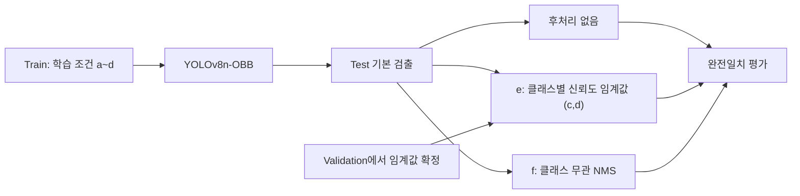

# YOLOv8-OBB 기반 음각 마킹 코드 인식

한국정보처리학회 ACK 2026 논문 **「클래스 무관 비최대억제를 적용한 YOLOv8-OBB 기반 음각 마킹 코드 인식」**의 연구 코드입니다.

금속 부품의 음각 문자를 회전 박스로 검출하고, 증강·이미지 단위 오버샘플링·후처리가 이미지 전체의 인식 정확도에 미치는 영향을 비교합니다. 평가는 문자별 클래스와 위치가 모두 맞고 추가 예측도 없는 **완전일치**를 사용합니다.

[실행 가이드](docs/getting_started.md) · [전체 결과 표](docs/results.md) · [논문과 코드의 대응](docs/method_mapping.md) · [재현 범위](docs/reproduction_status.md)

## 연구 구성

| 구분 | 비교 조건 |
| --- | --- |
| 모델 | DOTA 사전학습 YOLOv8n-OBB, 입력 크기 1280 |
| 학습 | (a) 기준 / (b) 오버샘플링 / (c) 증강 / (d) 결합 |
| 후처리 | (e) 클래스별 신뢰도 임계값 / (f) 클래스 무관 NMS |
| 데이터 | 이미지 500장, 28개 문자 클래스, 원본 분할과 무작위 재분할 세 종류 |
| 분할별 구성 | Train 350장 / Validation 75장 / Test 75장 |



기본 검출은 conf 0.30과 클래스별 NMS IoU 0.20을 사용합니다. 추가 클래스 무관 NMS의 IoU는 0.5입니다. 두 후처리는 기본 예측에 독립적으로 적용하며, 논문에서 (e)는 기반 모델 (c)와 (d)에 비교했습니다.

## 논문 보고 결과

다음은 논문 표 1의 Test 완전일치 결과입니다. 이미지 수는 네 분할의 평균±표준편차이며, 코드 정리 중 새로 측정한 값이 아닙니다.

| 학습 조건 | 완전일치 이미지 수 (장) | 완전일치율 (%) |
| --- | --- | --- |
| (a) 기준 | 62.2±3.8 | 83.0 |
| (b) 오버샘플링 | 61.5±2.6 | 82.0 |
| (c) 증강 | 71.8±1.5 | 95.7 |
| (d) 오버샘플링 + 증강 | 71.0±2.9 | 94.7 |

이번 실험에서는 증강이 완전일치 향상의 주된 요인이었고, 이미지 단위 오버샘플링의 추가 이득은 확인되지 않았습니다. 클래스 무관 NMS의 결과와 신뢰구간은 [전체 결과 표](docs/results.md)에 정리했습니다.

## 데이터와 가중치

이 저장소는 코드·설정·분할 명세를 제공합니다. 원본 이미지·라벨, 사전학습 및 학습 가중치, 예측 파일은 포함하지 않으며 다운로드 링크도 제공하지 않습니다.

실행에는 기존 클래스 순서의 YOLO OBB 라벨과 로컬 가중치가 필요합니다. 데이터 형식과 준비 방법은 [실행 가이드](docs/getting_started.md)를 참고하세요.

## 설치 및 실행

저장소 루트에서 실행합니다. 장비에 맞는 PyTorch/CUDA 환경을 준비한 뒤 의존성을 설치합니다.

```bash
python -m pip install -r "requirements.txt"
```

데이터 준비와 `configs/dataset.example.yaml`의 경로 설정 후, 증강 조건 (c)는 다음과 같이 학습합니다.

```bash
python "code/train.py" --experiment c --data "configs/dataset.example.yaml" --weights "/path/to/yolov8n-obb.pt" --output "runs/c_origin"
```

저장된 Test 예측에 클래스 무관 NMS를 적용해 평가합니다.

```bash
python "code/evaluate.py" --gt "data/origin/labels/test" --pred "predictions/c_origin_test/labels" --post nms --output "results/c_origin_nms.json"
```

분할 복원, 차등 복제, 예측 생성, 신뢰도 임계값 비교와 출력 형식은 [전체 실행 가이드](docs/getting_started.md)에 있습니다. 의존성 목록과 실제 검사 환경은 [환경 기록](docs/environment.md)에서 구분합니다.

## 폴더 구성

```text
code/           학습·추론·평가·복제·분할 복원
configs/        데이터 경로 예시와 28클래스 순서
splits/         네 분할의 파일 목록과 해시
tests/          합성 입력을 이용한 단위 검사
docs/           실행법·결과 표·구현 대응·재현 범위
```

## 검증 및 재현 범위

연구 함수의 원문 일치, CLI 도움말과 합성 입력 단위 검사를 확인했습니다. 실제 데이터로 학습·추론·성능 평가를 다시 실행하지 않았으며, 평가 CLI는 지정한 한 분할의 결과를 출력합니다.

조사한 보존 자료에서 네 모델·16회 NMS 적용 전체를 연결하는 실행 자료와 최종 그림 생성기는 확인되지 않았습니다. 전체 실험을 재현했다고 주장하지 않으며, 구체적인 확인 상태와 보존 CSV의 차이는 [재현 범위](docs/reproduction_status.md), 코드 검사 결과는 [검증 기록](docs/verification.md)에 명시했습니다.

연구 코드의 원본 출처와 변경 범위는 [출처 기록](docs/provenance.md)에 있습니다.
